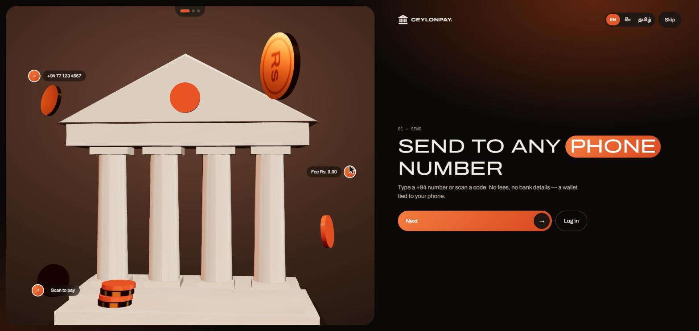
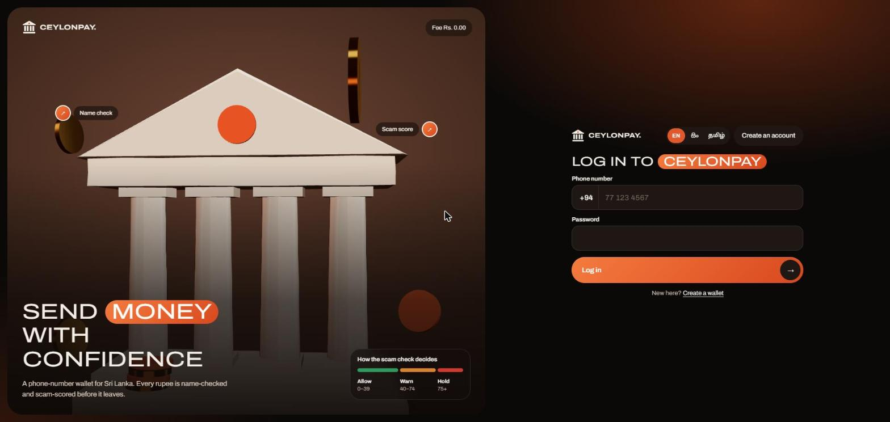
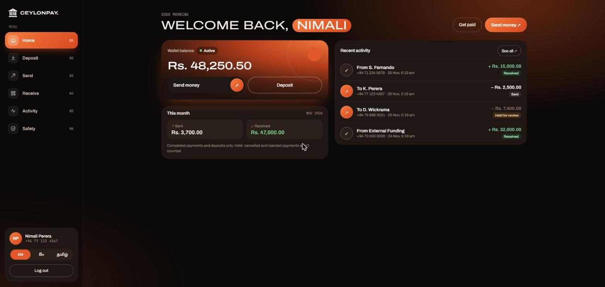
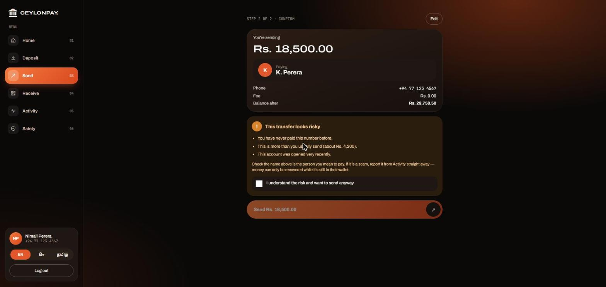
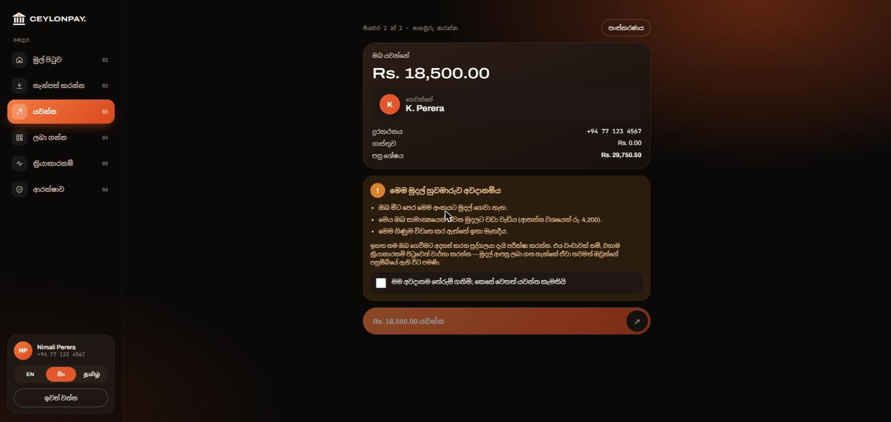
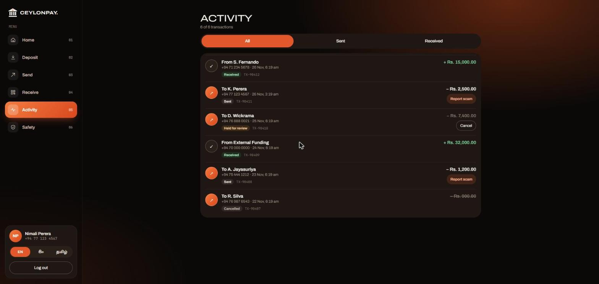
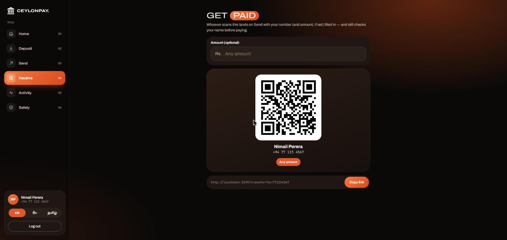
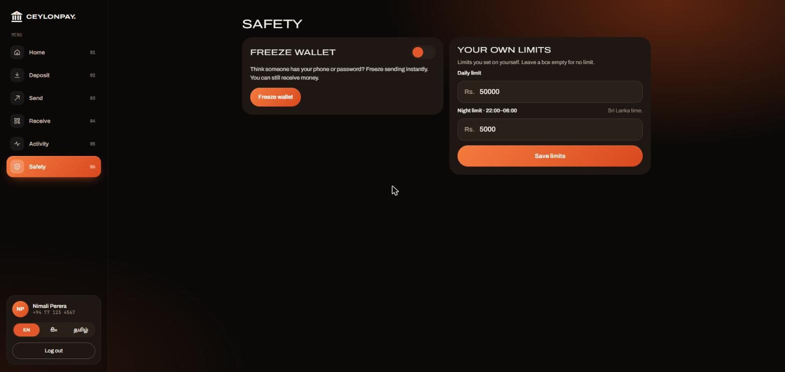
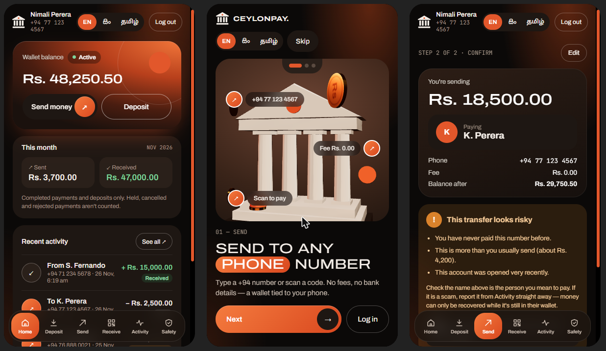

# CeylonPay

A wallet and peer-to-peer payment app for Sri Lanka, with a scam shield built into every transfer. Spring Boot and PostgreSQL on the back, React on the front. Users register, deposit money, send it to other people by phone number, and get warned (or stopped) when a payment looks like a scam.

> **This is a learning project.** I built it to learn Java and Spring Boot end to end: REST APIs, Spring Security with JWT, JPA and Flyway migrations, database transactions, a transactional outbox, rate limiting, and testing. The money is simulated (deposits come from a fake funding source), and it is not a licensed payment service. Please do not put real money or real personal data into it.

**Live:** [ceylonpay.vercel.app](https://ceylonpay.vercel.app) (frontend) · [ceylonpay-api.onrender.com](https://ceylonpay-api.onrender.com) (API)

> **If the first request is slow or shows "The server is waking up":** the API runs on a free host that puts it to sleep when nobody is using it. See [Gateway timeouts and the sleeping server](#gateway-timeouts-and-the-sleeping-server).

## Screenshots

| | |
|---|---|
|  |  |
| **Welcome.** Three intro slides over a 3D bank (three.js). New visitors land here after the opening splash. | **Log in.** The same 3D scene beside the form. EN, සිං and தமிழ் can be switched before logging in. |
|  |  |
| **Home.** Balance, this month's totals and recent activity. | **Scam shield.** A risky transfer shows the reasons and needs the sender to confirm. |
|  |  |
| **Sinhala (and Tamil).** The whole app, including the warning text, in the chosen language. | **Activity.** Sent, received and held payments, with *Cancel* and *Report scam*. |
|  |  |
| **Get paid.** A QR code (and link) for your number and an optional amount. | **Safety.** Freeze the wallet, or set your own daily and night limits. |

On a phone the sidebar becomes a bottom bar and everything stacks:



The screenshots were taken from the running app with sample data.

## Features

- **Authentication** — register and log in with a Sri Lankan phone number and password; short-lived JWT access tokens with rotating refresh tokens.
- **Wallet** — every account gets a wallet on registration; check balance, deposit funds.
- **Peer-to-peer transfer** — send money to any other user by phone number, with name check, balance and self-transfer validation, executed atomically.
- **Scam shield** — every transfer gets a risk score; risky ones warn, the riskiest are held for a reviewer. Senders can report a scam and get money back while it is still in the receiver's wallet. See [Scam protection](#scam-protection).
- **Scan to pay** — QR codes that open the Send page with the number and amount filled in.
- **Three languages** — English, Sinhala and Tamil across the whole app.
- **Transaction history** — a combined, direction-aware view of everything sent and received.
- **React frontend** — warm dark design with an animated splash, intro slides and a 3D scene, a sidebar on desktop and a bottom bar on phones.

## Tech stack

**Backend:** Java 21 · Spring Boot 4.1.1 · Spring Security · Spring Data JPA / Hibernate · Flyway · PostgreSQL · JJWT · Redis (optional, for shared rate limits) · Maven

**Frontend:** React 19 · Vite · React Router · three.js (3D scene, loaded only on the intro and sign-in screens) · GSAP (splash animation) · Vitest

**Infrastructure:** Docker (multi-stage build) · Render (API) · Supabase (PostgreSQL) · Vercel (frontend)

## What I learned building it

- **Money needs care:** `BigDecimal` for amounts, and `@Transactional` so a transfer either fully happens or not at all.
- **Security is mostly details:** JWT access tokens that expire fast, refresh tokens stored only as a hash and rotated on every use, rate limits on the sensitive endpoints, and every query scoped to the logged-in user.
- **Schema changes belong in migrations:** Flyway owns the schema and Hibernate only validates it.
- **Events without losing any:** the transactional outbox writes an event in the same transaction as the money movement, and a publisher sends it on later, at least once.
- **Free hosting has sharp edges:** a sleeping server, a free database that expires or pauses, and gateway timeouts. Those are written up below because they look like bugs but are not.
- **Tests as a safety net:** 69 backend tests and 118 frontend tests (including a check that every screen draws in all three languages).

## Project structure

```
CeylonPay/
├── src/main/java/lk/ceylonpay/
│   ├── controller/     REST endpoints
│   ├── service/        business logic (auth, wallet, transfer)
│   ├── entity/          JPA entities (User, Wallet, Transaction, AuditLog)
│   ├── repository/      Spring Data JPA repositories
│   ├── security/        JWT generation/validation, auth filter
│   ├── config/           Spring Security config, global exception handling
│   ├── dto/              request/response records
│   └── exception/        domain-specific exceptions
├── src/test/java/lk/ceylonpay/   unit + integration tests
├── frontend/                      React app (Vite)
├── Dockerfile                     multi-stage backend build
├── docker-compose.yml            backend + Postgres for local dev
└── pom.xml
```

## API overview

| Method | Endpoint | Auth | Description |
|---|---|---|---|
| POST | `/api/auth/register` | — | Create an account and wallet |
| POST | `/api/auth/login` | — | Log in, receive an access token and a refresh token |
| POST | `/api/auth/refresh` | — | Swap a refresh token for a new pair |
| POST | `/api/auth/logout` | — | Revoke the login session |
| GET | `/api/wallet/balance` | ✓ | Current wallet balance |
| POST | `/api/wallet/deposit` | ✓ | Deposit funds |
| GET | `/api/users/lookup` | ✓ | Name check: who owns a phone number |
| POST | `/api/transfer/risk-check` | ✓ | Score a transfer before sending (allow, warn or hold) |
| POST | `/api/transfer` | ✓ | Send money to another user by phone |
| POST | `/api/transfer/otp` | ✓ | Text a one-time code for a risky transfer (when codes are on) |
| POST | `/api/transfer/{id}/cancel` | ✓ | Cancel a transfer that is held for review |
| POST | `/api/transfer/{id}/report` | ✓ | Report a completed transfer as a scam |
| GET | `/api/transactions` | ✓ | Transaction history (sent + received) |
| GET / PUT | `/api/safety` | ✓ | Freeze the wallet, set daily and night limits |
| POST | `/api/account/phone/request` · `/verify` | ✓ | Verify your phone number (when codes are on) |
| GET / POST | `/api/admin/**` | admin | Review held transfers and scam reports, mule list, outbox |

Authenticated requests need `Authorization: Bearer <token>`.

## Running locally

### Prerequisites

- Java 21
- Maven
- PostgreSQL (or Docker)
- Node.js 18+ (for the frontend)

### Backend

Create a local `ceylonpay` PostgreSQL database, then:

```bash
mvn spring-boot:run
```

The schema is managed by Flyway (`src/main/resources/db/migration`) and applied automatically at startup; Hibernate only validates it. Defaults to `localhost:5432`, database `ceylonpay`, user/password `postgres` — see `src/main/resources/application.properties`. The API starts on port `8080`.

### Frontend

```bash
cd frontend
npm install
npm run dev
```

Starts on `http://localhost:5173` and expects the API at `http://localhost:8080` (override with a `VITE_API_BASE_URL` environment variable). If the API is not running you can still see the welcome, log in and register screens, but nothing that needs the server.

### With Docker Compose

```bash
docker-compose up
```

Runs the API and a PostgreSQL instance together. Requires a `JWT_SECRET` environment variable to be set.

## Running tests

```bash
mvn test              # backend — JUnit 5 + Mockito, unit and integration tests
cd frontend && npm test   # frontend — Vitest
```

## Design notes

- **Money** is always `BigDecimal`, never a floating-point type — precision matters when the numbers are currency.
- **Transfers are atomic** — `@Transactional` ensures a transfer either fully succeeds (both balances updated, transaction and audit log recorded) or fully rolls back on any failure.
- **Access control is resource-scoped** — a user's JWT identifies them; every wallet/transaction lookup is implicitly scoped to that identity rather than gated by a separate permission check.
- **Configuration is environment-driven** — the same jar runs locally, in Docker, and on Render, with only environment variables changing between them (database connection, JWT secret, allowed CORS origins).

## Scam protection

- **Name check** — before sending, the app shows who owns the number (`K. Perera`).
- **My Safety** — freeze your wallet, or set your own daily and night (22:00–06:00) limits.
- **Scam Shield** — every transfer gets a 0–100 risk score from transparent rules (first payment to this number, much larger than usual, almost all of your balance, brand-new receiving account, receiver collecting from many people, and more). Below 40 it goes through, 40–74 the sender must confirm the warnings, 75+ the transfer is **held**: no money moves until an admin approves it (`/api/admin/reviews`) or the sender cancels it. Rules live in `risk/RiskService.java`.

- **Report and recover** — a sender can press *Report scam* on a completed transfer. The receiving account's outgoing money is put on hold immediately (the user can't lift it). A reviewer on the **Review** page (admins only) either upholds the report, which pulls back what the receiver still has as a new ledger counter-transfer (history is never edited) and flags the account in future risk scores, or dismisses it and lifts the hold.

- **Mule detection** — the Review page lists accounts that received from 3+ different people in 24 hours *and* pass the money on, are new, or are already reported. An admin can hold such an account (it can still receive, not send) or release it. This is rule-based; a trained model needs real labelled data, and the upheld/dismissed scam reports are what will provide it.
- **Sinhala, Tamil and English** — pick a language with the EN / සිං / தமிழ் switch (it is on the welcome and log-in screens too). Risk reasons are returned as stable codes with their numbers, and the app shows fixed translations of them (`frontend/src/i18n/strings.js`). The rest of the screens use a phrase table (`frontend/src/i18n/phrases.js`) keyed by the English text; anything missing falls back to English, and a test fails if marked text has no Sinhala or Tamil line. Have a fluent speaker review the Sinhala and Tamil before launch. The admin screen and messages written by the server stay in English.

## Sessions

Access tokens last 15 minutes. Login also returns a **refresh token** (30 days, stored only as a hash) that the app uses to renew the access token quietly. Refresh tokens rotate on every use; if an already-used token is presented again, the whole login session is revoked. `POST /api/auth/logout` revokes the session. Configure with `jwt.expiration-ms` and `jwt.refresh-expiration-days`.

## One-time codes (SMS)

Off by default, because codes are only useful once an SMS provider is connected. When `CEYLONPAY_OTP_ENABLED=true`: new accounts must verify their phone (a 6-digit code) before they can send money, and a transfer that carries a risk warning also needs a fresh code texted to the sender, valid only for that recipient and amount. Codes last 5 minutes, allow 5 wrong tries, and can be re-requested every 30 seconds. Existing accounts are treated as verified. Messages go through the `SmsSender` interface; the built-in implementation only logs them (development), so add one for your provider (Dialog, Mobitel or a bulk-SMS gateway) and set `ceylonpay.sms.provider` to its name. For local demos, `CEYLONPAY_SMS_DEV_CODE_IN_RESPONSE=true` returns the code in the API response and shows it in the UI. Never set that in production.

## Scan to pay

**Receive** shows a QR code for your number, with an optional amount. It encodes a link to the Send page (`/transfer?to=771234567&amount=500`), so any phone camera can open it, and the in-app **Scan a QR code** button on Send reads it where the browser supports `BarcodeDetector` (Chrome and Edge). Scanning only fills in the form: the name check, risk warning and confirmation all still apply. If you are logged out, you are sent to login and then back to the link. This is CeylonPay-to-CeylonPay only; it is not the interbank LankaQR standard, which needs a bank or payment-switch connection.

## Rate limiting

Login, registration, token refresh, codes, transfers and name lookups are limited per client address and path (for example 10 logins a minute). By default the counts live in the app's memory, which is right for a single instance. With several instances each would count separately, so set `CEYLONPAY_RATE_LIMIT_STORE=redis` and `SPRING_DATA_REDIS_URL` (for example `redis://host:6379`) to share the counts. If Redis cannot be reached, requests are let through and the error is logged, so a Redis outage does not stop payments.

## Events (outbox)

Every transfer, hold, cancellation, report and reversal writes an event to the `outbox_events` table in the same database transaction, so an event exists if and only if the money moved. `OutboxPublisher` then sends them on, at-least-once, through the `EventPublisher` interface. Choose the sink with `CEYLONPAY_EVENTS_SINK`:

- `log` (default): writes events to the log. Development only.
- `webhook`: POSTs each event as JSON to `CEYLONPAY_EVENTS_WEBHOOK_URL`, signed with `CEYLONPAY_EVENTS_WEBHOOK_SECRET`. Headers: `X-CeylonPay-Event-Id`, `X-CeylonPay-Event-Type`, `X-CeylonPay-Timestamp` and `X-CeylonPay-Signature` (hex HMAC-SHA256 of `timestamp + "." + body`). The receiver should check the signature and the timestamp, and ignore an event id it has already seen. Any non-2xx answer counts as a failure.

A failed event is retried with backoff (10 s, 20 s, 40 s, up to 10 min). After 5 failures it is parked as dead. Admins see the count of waiting events and the dead ones at `GET /api/admin/outbox` and can put one back with `POST /api/admin/outbox/{id}/requeue`. Several app instances can run at once without sending an event twice. To use Kafka, SQS or RabbitMQ, add one class implementing `EventPublisher`.

## Gateway timeouts and the sleeping server

If the page seems stuck, or shows **"The server is waking up. This can take up to a minute — try again shortly."**, nothing is broken. This is what happens on free hosting.

**What is going on**

1. The API runs on Render's free web service. After about 15 minutes with no traffic Render stops it.
2. The next request has to start the whole Java app again (JVM, Spring, database connection pool, Flyway check). That takes roughly 30 to 60 seconds.
3. While it starts, Render's gateway answers instead of the app. If the app takes too long, the gateway gives up with **502 Bad Gateway**, **503 Service Unavailable** or **504 Gateway Timeout**. Those answers are plain HTML pages, not the JSON the API normally sends.
4. The database can be asleep too. A free Supabase project pauses after a week without use and must be restored from its dashboard. A free Render Postgres is deleted after about 30 days, which is why this project moved to Supabase.

**What the app does about it**

- A 502, 503 or 504 (or no answer at all within 65 seconds) is shown as *"The server is waking up…"* in the person's language, instead of a confusing error or a blank screen. Log in and Create wallet show it directly.
- The error page is never parsed as JSON, so the app does not crash on it (`frontend/src/api/client.js`, covered by tests).
- Nothing is lost: a transfer that gets a gateway error was never sent, and the screen says nothing left the wallet.

**What you can do**

- Wait a minute and try again. The second attempt is fast.
- To avoid it altogether, use a paid instance, or call any public URL of the API every 10 minutes from a free monitor to keep it awake.
- If the error does not go away after a few minutes, check the Render logs. A wrong database password shows up as *password authentication failed*, and a paused Supabase project as connection timeouts.

## Admin access

`/api/admin/**` requires the `ADMIN` role (carried as a claim in the JWT). Nobody can become an admin through the API. Register the account first, then set `CEYLONPAY_ADMIN_PHONE` to its phone number and restart; the account is promoted at startup.

Phone numbers are stored in one canonical form (`+947XXXXXXXX`); `0771234567` and `+94771234567` are the same account.

## Known limitations

- CORS origins and the JWT secret are configured via environment variables but are not rotated or vaulted — fine for a demo deployment, not production-hardened.
- Deposits are simulated and no real bank or card is connected. Do not use real money.
- The free hosting sleeps and can answer with gateway timeouts, see above.
- SMS codes are off by default, and the built-in sender only logs messages until an SMS provider is connected.
- The Sinhala and Tamil text has not been reviewed by a fluent speaker yet.
- The Admin screen is English only.
